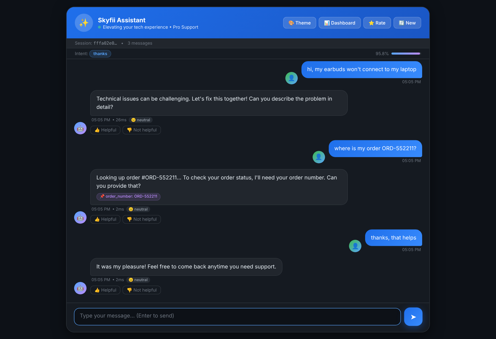

# Customer Support Chatbot

A support chatbot for a fictional electronics store ("Skyfii"). It recognises what the customer wants across 18 intents, pulls out order numbers, emails and amounts, notices frustration or urgency, and hands anything it doesn't recognise to Gemini. Every conversation is logged in SQLite and shown on an analytics dashboard.

Built with Python, Flask, scikit-learn and SQLite. It runs on a free Render instance.



## Measured accuracy

The intent model is evaluated on **123 customer messages it never saw in training**. They were written to sound like real customers ("my earbuds won't connect to my laptop", "money got debited but order failed"), and 15 of them are out of scope ("give me a recipe for dosa"). Reproduce the numbers with `python scripts/evaluate.py`.

| Model | In-scope accuracy | Macro F1 | Out-of-scope correctly rejected | Real questions wrongly rejected |
|---|---|---|---|---|
| Keyword matcher (previous version) | 49.1% | 51.6% | 80.0% | 27.8% |
| **TF-IDF + logistic regression (current)** | **86.1%** | **90.2%** | **86.7%** | **10.2%** |

How the numbers were produced:

- **Dev set (205 messages).** Used to study errors, add training patterns and choose the "unknown" threshold (0.38).
- **Test set (123 messages).** Written before any tuning, used only for the table above. No test or dev message appears in the training data; the script checks this every time it runs.
- **Before adding training patterns.** The classifier scored 74.1% on the same test set. Adding 107 patterns, informed by dev-set errors only, raised it to 86.1%.
- **The keyword matcher** is the earlier approach, rebuilt from the same training data so the comparison is fair.

What it still gets wrong: very short or vague messages ("is it expensive?"), and messages that mix two intents ("can I cancel after shipping"). The next step is to log the low-confidence messages from real users and label them.

The dashboard's sample numbers come from `setup.py`, which seeds about 5,200 *synthetic* conversations so the charts have something to show. They are not real usage.

## How it works

```
message ─▶ sentiment + urgency (rules) ─▶ intent classifier ─┬─ confident ─▶ answer from intents.json
                                         (TF-IDF word 1-2 grams + char 2-5 grams,     + entities (order no., email, ₹/$)
                                          logistic regression)  └─ unsure ───▶ Gemini fallback (if GEMINI_API_KEY)
                                                                                └─ else "could you rephrase?"
every turn ─▶ SQLite log ─▶ analytics API ─▶ dashboard
```

- **Why character n-grams:** they tolerate typos and word forms ("refnd", "charged" / "charge") without needing NLTK data downloads at runtime.
- **Why logistic regression, not a neural network:** with 369 short training patterns, a linear model on TF-IDF features is accurate and trains in about a second. It is also small enough for a free 512 MB instance; the old TensorFlow model was too heavy to deploy, so production had silently been running the keyword matcher.
- **Unknown detection:** if the top probability is below the threshold chosen on the dev set, the bot does not guess.
- **Gemini fallback:** a REST call to `gemini-2.5-flash` (the old `google-generativeai` SDK is no longer supported). It is used only when the classifier is unsure, and errors fall back to a polite "please rephrase".

## Run it

```bash
python -m venv .venv && .venv\Scripts\activate      # macOS/Linux: source .venv/bin/activate
pip install -r requirements.txt
python setup.py                 # keyword model + demo database
python scripts/evaluate.py      # train the classifier and print the accuracy table
python run.py                   # http://localhost:5000  and  /dashboard
pytest -q                       # 58 tests, including an accuracy gate
```

Optional: set `GEMINI_API_KEY` in `.env` to answer out-of-scope questions. The TensorFlow trainer in `scripts/train_model.py` is kept for experiments and is not used in production.

## API

| Method | Endpoint | Description |
|---|---|---|
| POST | `/api/chat/session` | Create a chat session |
| POST | `/api/chat/message` | Send a message, get the reply, intent, confidence, entities and sentiment |
| GET | `/api/chat/history/<id>` | Conversation history |
| POST | `/api/chat/feedback` | 1–5 star rating |
| GET | `/api/analytics/dashboard` | Dashboard data |
| GET | `/api/analytics/intents` | Per-intent counts and confidence |
| GET | `/api/analytics/unknown-queries` | Messages the bot did not understand (to label next) |
| GET | `/api/analytics/model-info` | Model type, threshold and measured accuracy |
| POST | `/api/admin/test-prediction` | Test a prediction without logging (needs `X-API-Key`) |
| GET | `/health` | Health check |

## Project layout

```
app/intent_classifier.py   TF-IDF + logistic regression, save/load, threshold
app/chatbot_engine.py      pipeline: sentiment, intent, entities, responses, Gemini fallback
app/routes.py, database.py Flask API and SQLite (7 tables, WAL mode)
data/intents.json          18 intents: training patterns and responses
eval/                      dev and test message sets
scripts/evaluate.py        trains, picks the threshold on dev, reports on test
tests/                     unit, API and accuracy-gate tests
```

## Deploy

`render.yaml` and `build.sh` deploy to Render. The build installs the requirements, builds the demo database, then trains and evaluates the classifier. Set `GEMINI_API_KEY` in the Render dashboard to turn on the fallback.
